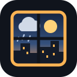
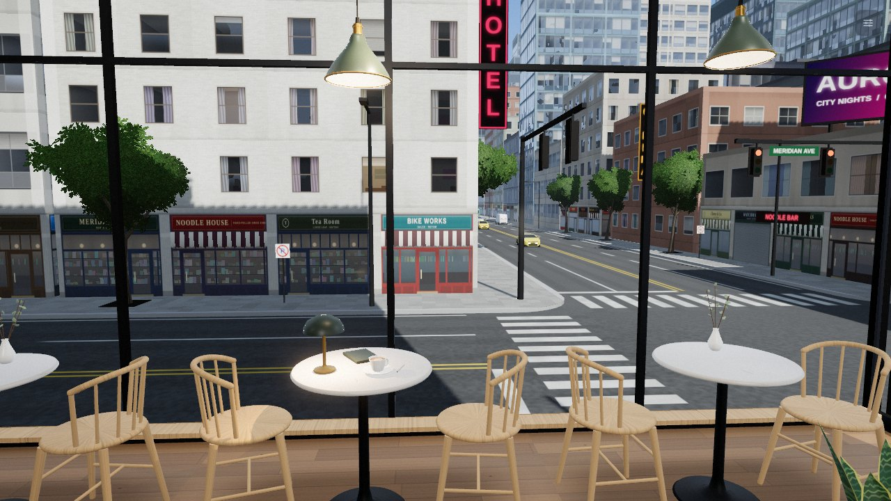
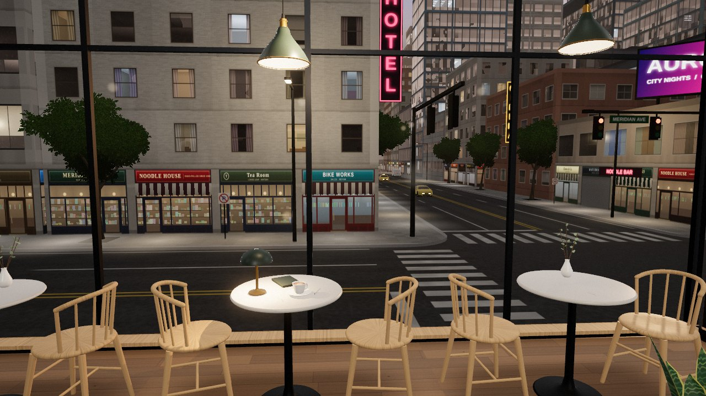
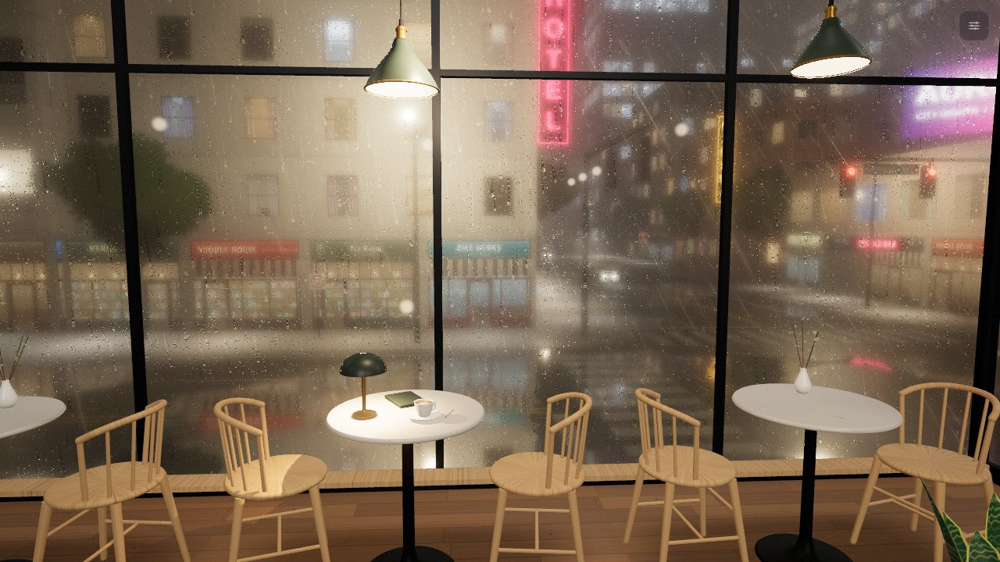
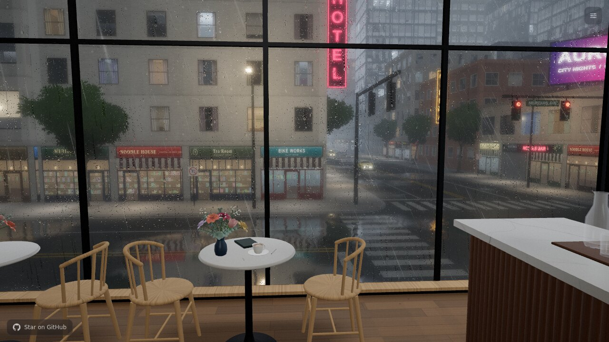
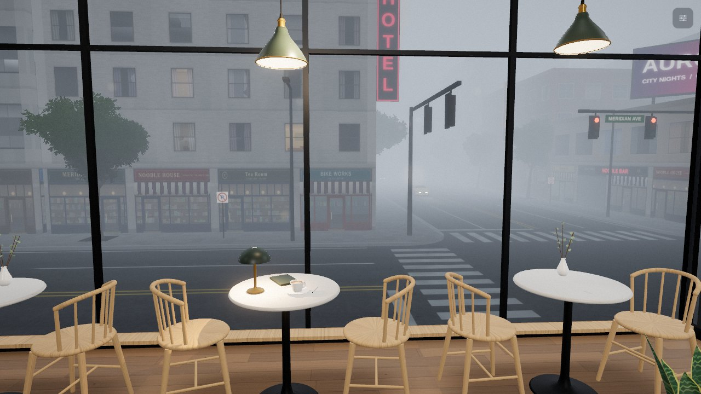
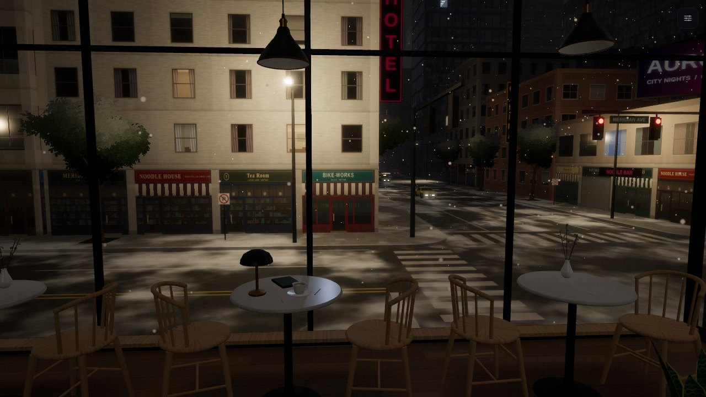
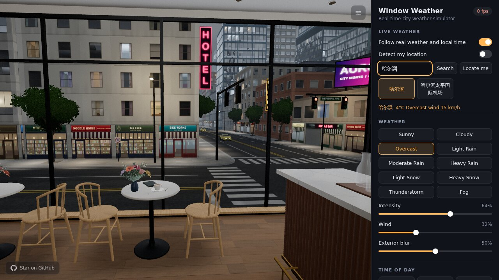

<p align="center"></p>

# Window Weather · 窗边天气

一个完全运行在浏览器里的实时 3D 天气场景：坐在二楼咖啡厅的窗边，隔着玻璃看楼下的城市路口。
可以手动设置天气和时间，也可以接入实时天气，让窗外跟着真实城市此刻的天气和当地时间变化。

预览地址：<https://renderlab.top/>

所有画面都是程序生成的 —— 模型、贴图、招牌、雨滴、雪和天空都由代码、canvas 和着色器实时绘制，
没有任何图片、视频或模型文件。

| | |
| --- | --- |
|  晴天上午 |  多云傍晚 |
|  大雨夜晚 |  大雪 |
|  晨雾 |  打烊后的雪夜 |

## 功能

- **10 种天气**：晴、多云、阴、小雨、中雨、大雨、小雪、大雪、雷暴、雾，每种都可调强度和风力
- **连续的一天**：日出日落、月亮和星空、路灯和楼窗随时间亮灭；咖啡厅的灯默认只在 18–22 点亮，可随时手动开关
- **实时天气**：打开页面即自动定位，同步当地天气、风力和时间；也可以手动选城市
- **窗玻璃**：水珠、下滑的水痕、雾气、折射和室内灯光的反光
- **街道**：会跟车、等红灯、转弯的车流（轿车、SUV、皮卡、出租车、公交车等），路面积水倒影和积雪车辙
- **自由视角**：可以在咖啡厅里走动和环顾
- **自适应画质**：低 / 中 / 高三档，帧率过低时自动降档

## 实时天气



默认开启。打开页面时按 IP 地址估算所在城市（不弹权限提示），时间用浏览器的时区，然后：

- 每 10 分钟获取一次该地的当前天气，自动换算成场景的天气类型、强度和风力
- 场景时间跟随当地时间

也可以在面板顶部的 **Live weather** 里点一个城市，或输入城市名（支持中文，优先匹配国内城市）后搜索，
这时时间改为该城市的当地时间；**Locate me** 使用浏览器的精确定位。
手动选择天气或时间、或打开自动昼夜循环时，实时模式自动关闭，这个选择会被记住。

天气数据来自 [Open-Meteo](https://open-meteo.com/)（免费、无需密钥，非商业用途），
IP 定位依次尝试 [ipwho.is](https://ipwho.is/) 和 [IP.SB](https://ip.sb/)，定位失败时用上次的城市。
只有开启实时模式时才会发出这些请求，都由浏览器直接发给对应服务，不经过本项目的服务器。

天气换算规则（WMO 天气代码）：

| 实况 | 场景天气 | 强度依据 |
| --- | --- | --- |
| 0–1 晴 | Sunny | 云量 |
| 2 少云 / 3 阴 | Cloudy / Overcast | 云量 |
| 45、48 雾 | Fog | 固定 |
| 51–61、66、80 毛毛雨、小雨 | Light Rain | 降水量 |
| 63、81 中雨 | Moderate Rain | 降水量 |
| 65、67、82 大雨 | Heavy Rain | 降水量 |
| 71、73、77、85 小到中雪 | Light Snow | 降水量 |
| 75、86 大雪 | Heavy Snow | 降水量 |
| 95–99 雷暴 | Thunderstorm | 降水量 |

风力按 45 km/h 及以上为 100% 线性换算。

## 运行

```
npm install
npm run dev       # 开发服务器（默认 http://127.0.0.1:5173，端口被占用时顺延）
npm run build     # 生产构建，输出到 dist/
npm run preview   # 预览生产构建
```

需要 Node 20.19+ 和支持 WebGL 2 的浏览器。

## 操作

| 分组 | 控件 |
| --- | --- |
| Live weather | 实时模式开关、自动定位开关、城市搜索、精确定位 |
| Weather | 10 种天气、强度、风力、窗外模糊 |
| Time of day | 6 个时段、连续时间滑块、自动昼夜循环及速度 |
| Scene | 玻璃雨滴、车流开关和密度、顶灯、菜单屏亮度 |
| Playback and quality | 暂停、重置、全屏、画质、帧率 |
| Scene configuration | 整个状态的 JSON，可复制、编辑、应用 |

| 按键 | 作用 |
| --- | --- |
| 拖动 | 环顾 |
| `W` `A` `S` `D` / 方向键 | 行走（`Shift` 加速） |
| `Q` / `E` | 降低 / 升高 |
| 滚轮 | 缩放 |
| `R` / 双击 | 回到默认视角 |
| `Space` | 暂停 |
| `H` | 隐藏面板 |
| `F` | 全屏 |

设置保存在 `localStorage`，下次打开自动恢复。
URL 参数：`?quality=low|medium|high`、`?autoquality=0`（关闭自动画质调整）。

## 代码结构

```
src/
  main.js                     启动
  core/App.js                 渲染器、室内外两个场景、帧循环、自由视角
  core/Store.js               唯一状态源：带校验、可序列化
  core/PerformanceManager.js  画质档位、帧率监测、自动降档
  core/layout.js              世界尺寸、房间和相机位置
  render/                     窗外 HDR 渲染目标、模糊和光晕、最终调色
  sky/SkyDome.js              程序化天空、日月、星星、云
  city/CityBuilder.js         地面、人行道、实例化建筑、招牌
  city/BuildingMaterial.js    着色器生成的立面、门店、窗户和窗后房间
  city/GroundMaterial.js      柏油、标线、积水倒影、积雪和车辙
  city/StreetFurniture.js     路灯、红绿灯、路牌、树
  city/Vehicles.js            实例化车辆和车灯
  city/TrafficSystem.js       路线、信号灯、跟车、转弯
  room/RoomBuilder.js         咖啡厅：吧台、桌椅、射灯、绿植
  room/WindowGlass.js         玻璃：水珠、水痕、雾气、折射、反光
  systems/TimeSystem.js       时间 -> 日月位置和晴空光照
  systems/WeatherSystem.js    天气类型 x 强度 -> 平滑过渡的天气参数
  systems/LightingSystem.js   统一驱动两个场景里的所有光源
  systems/LiveWeather.js      实时天气：城市搜索、天气代码换算、当地时间
  weather/Precipitation.js    GPU 雨雪粒子
  weather/LightningSystem.js  闪电时机和电弧网格
  ui/UIController.js          控制面板
```

每一帧：更新各系统 -> 把城市渲染到独立的 HDR 目标（外加一张低分辨率镜像用于湿路面倒影）->
柔焦和光晕 -> 渲染咖啡厅，玻璃着色器在其中合成城市画面 -> 泛光、曝光、色调映射。
城市单独成像，所以雨天的模糊和雾不会影响到室内。

## 画质档位

| 档位 | 分辨率 | 说明 |
| --- | --- | --- |
| High | 原生，最高 1.5x 设备像素比 | 4x MSAA，2048 阴影，面光源，8 盏真实路灯 |
| Medium | 0.8x | 2x MSAA，1024 阴影，点光源替代，4 盏真实路灯 |
| Low | 0.6x | 无 MSAA、阴影、倒影和泛光 |

首次访问时集成显卡从 Medium 开始。帧率持续低于 24 fps 时先逐步降低内部分辨率，再降档；
手动选过档位后不再自动调整。

## 部署

`npm run build` 后把 `dist/` 交给任意静态服务器即可。`deploy/` 里有一份 nginx + Docker Compose 的示例配置。

## 许可

[MIT](LICENSE)
